# Scalemaker HRis — Product Showcase

Scalemaker HRis is an HRIS and applicant tracking system (ATS) built for small employers and the HR consultants who support them. It covers the full employee lifecycle in one place: recruiting, hiring, onboarding, the employee record, time and attendance, leave, messaging, offboarding, and company structure.

**Built for the employee who uses it twice a year, not the administrator who uses it twice a day.** Every screen is checked against the question "Would someone who hasn't logged in for six months know exactly what to do?", and admin depth stays behind the scenes.

This repository is a **portfolio showcase**. It describes the product's design and shows screenshots taken in a demo environment. It contains no application source code, no configuration, and no customer data. Every person and company shown is a fictional demo record.

---

## Highlights

- **Two-tier data model (Soft and Full)** that lets a company start without collecting sensitive personal data.
- **Human-decides gates.** A person extends every offer, and the candidate accepts. Hire runs on acceptance only when the company turns that on. Nothing rejects a candidate on its own.
- **Guided hire-to-onboard flow.** Acceptance runs Hire when the company turns that on. Otherwise a person chooses Hire. The person is Pending start, or Pending contingencies while required checks are open, and Active on the start date. The HRis invite, password, and mandatory new-hire wizard follow.
- **One role-aware shell.** Plain menu labels, My Desk pinned for employees, a home that fits the role, and buttons only when that person can use them.
- **What needs you.** My Desk opens on the tasks that need you. Each task links straight to itself, with its due date in plain words.
- **Getting started.** A new user follows three plain steps: create your password, secure your account, and you're ready.
- **Fine-grained roles** with per-module permissions and applicant scope.
- **Multi-company consulting.** Consultants see only the companies assigned to them, and their home shows setup status.
- **Tasks** grouped by person for admins, with recruiting to-dos included.
- **ATS** with stage interviewers, paused jobs, video interviews, calendar-aware self-scheduling, rescheduling with limits, and an append-only scheduling history. Applicants review a resume prefill before they submit.
- **Company directory** of active employees, paged and filterable by name, location, and department.
- **Messages** with an Inbox for one-to-one conversations and Announcements for the whole company. Messaging stays off until the company turns it on.
- **Leave desk** in Time. Managers see dates only. A long leave for a manager asks who covers the team.
- **Person fallback.** Work for someone who is terminated, exiting, or on leave goes to the next active person, and the handoff is logged.
- **Exits** for Soft and Full. A person confirms the exit, tasks route to roles, and direct reports get an interim owner before the last day.
- **Employment history** for job, pay, and manager changes, including changes dated in the future.
- **Compliance** for Form I-9, Form W-4, state withholding, and new-hire reporting, with a clear status on each person.
- **Voluntary EEO** on Soft and Full. Answers stay out of hiring views and are reported only as aggregate counts.
- **Company settings** for departments, recurring holidays, document types, and contacts.
- **Adding a new State?** guide in Company settings. It is HR guidance, not legal advice.
- **AI advisor** on fictional demo companies only. It helps people find a screen, and a person confirms any change.
- **Admin assist** with a clear banner and full audit attribution.

---

## Soft vs Full

Scalemaker HRis has two file types with the **same information architecture**. Users learn one set of screens, and the file type decides which data can be stored.

| | Soft | Full |
|---|---|---|
| Purpose | Day-to-day people operations without sensitive PII | Complete employment records, including sensitive PII |
| Sensitive PII | Never stored | Supported |
| New-hire wizard | No employee I-9; the manager confirms eligibility with a checkbox | Includes I-9 Section 1 and W-4 |
| Leave | Reason category, dates, status, balances, and notice dates; no documents | Medical certifications in a restricted medical file, separate from the personnel file; every view is logged |
| Exits | Reason category, notes, and document names | Reason category, notes, document names, and separation and release documents |
| EEO self-identification | Voluntary for applicants. Answers stay apart from the application | Same |
| Current status | In use | Holds fictional testers only until a penetration test and SOC 2 are complete |

Because the screens are the same, a company can move from Soft to Full later without retraining anyone.

---

## Human-decides gates

People make the hiring decisions:

1. A person decides to **extend every offer**. Offer and reject are separate actions.
2. The candidate decides to **accept**.
3. **Hire** runs on that acceptance only when the company turns on **Auto-hire when an offer is accepted**. Otherwise a person chooses Hire.
4. Nothing ever rejects a candidate on its own.

The AI advisor follows the same rule. It runs only on fictional demo companies. It can suggest a change, and a person confirms it.

---

## Hire to onboard

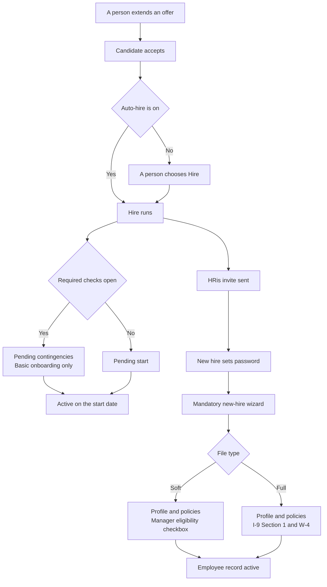

When **Auto-hire when an offer is accepted** is on, the candidate's acceptance runs the normal Hire flow. Otherwise a person chooses Hire, and that same flow runs. The person becomes **Pending start**, or **Pending contingencies** while a required background check, drug screen, or references are open. Only basic onboarding is released during contingencies. Employment status becomes **Active** on the start date. A person can rescind the hire before the start date. The hiring manager and admins are notified. Every step is logged.

The wizard is mandatory. A new hire cannot reach the rest of the app until it is complete.

Sending an offer, and the candidate accepting it, completes the matching hiring checklist steps. The Hire form's start date defaults to the start date in the accepted offer.

An admin can select several open onboarding tasks and email them to the new hire in one message. The admin previews the message first. It lists the task titles and due dates, and it includes a single sign-in link. It does not include personal details. On a Soft file, steps that stay with the manager are not selectable.

People search checks each word against the start of a name, so a last name on its own finds the person.

---

## One role-aware shell

Every user, whether employee, manager, admin, payroll, or consultant, signs in to the same shell. The work menu uses plain labels:

- **People**, which holds Directory, Company list, Org chart, and Exits
- **Tasks**
- **Time**
- **Hiring**
- **Compliance**
- **Reports**
- **Resources**
- **Messages**
- **Payroll export**
- **Company settings**

**My Desk** is pinned at the top for anyone who is also an employee. It opens with a **What needs you** card. Each task links straight to itself, with its due date in plain words. My Desk also holds the person's own record, tasks, calendar, time, leave, resources, messages, pay stubs, and exit tasks. Pay stubs open the company's own payroll provider when the company has set one.

Each role lands on a home that fits it:

- Managers see approvals and who is out today.
- Admins see one What needs you list.
- Payroll sees **Ready for payroll**.
- Consultants see setup status.

Buttons appear only when that person can use them.

Task and reminder emails carry one action button, such as **Review time-off request**, **Approve timesheet**, or **Complete your checklist**. They include no personal details.

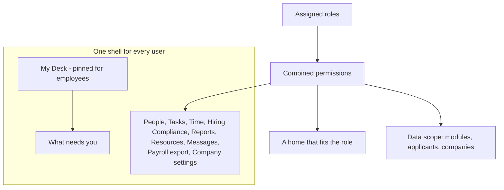

### Getting started

A new user gets one plain-language **Getting started** flow in three steps: create your password, secure your account, and you're ready. Someone on a computer with their phone follows one path. Someone using only their phone follows another. Help is tucked behind **Having trouble?**

### Roles and permissions

- Roles carry **per-module permissions** that can be expanded down to individual items.
- Built-in roles can be edited, and custom roles can be added.
- Recruiting roles include an **applicant scope**, so a user sees only the candidates they are meant to see.
- Managers see their reporting line.
- A user's access is the **sum of all their roles**, shown plainly on their own *My access* tab.

### Consultants and multiple companies

HR consultants can serve several client companies. A consultant sees **only the companies assigned to them**, listed under *Your Companies* on their My access tab. A consultant's home shows setup status.

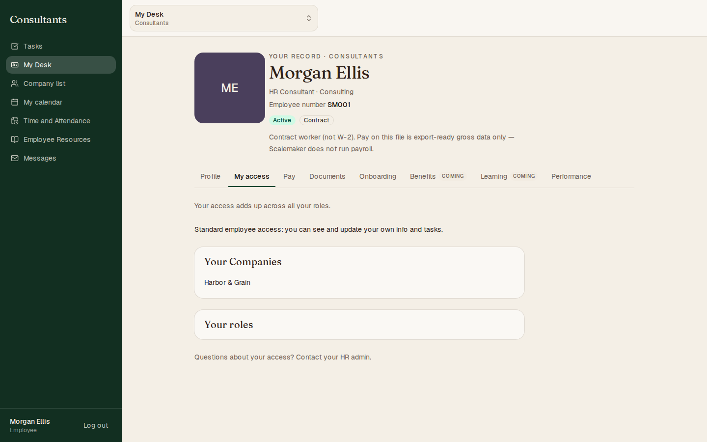

---

## Tasks

Admins see tasks grouped by person. **My tasks** is pinned at the top. **Unassigned** is listed on its own.

A company setting, off by default, lets managers see open tasks for their reporting line.

Recruiting to-dos also show on Tasks.

---

## Company directory

Every employee can browse the company directory. It lists active employees only. The list is paged, and it can be sorted and filtered by name, location, and department. Each row shows the name, job title, department, and location. Directory lives under People.

Opted-in profile notes stay on the person's profile. The directory is separate from role-based visibility and never shows sensitive PII.

When Messages is on, choosing a name opens a conversation.

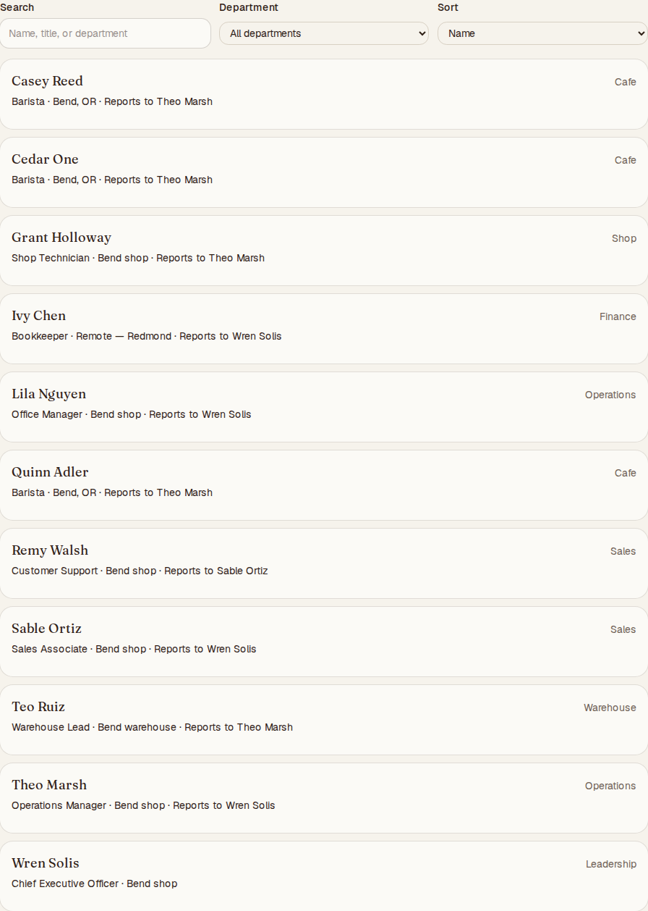

## Messages

Messages is one menu item with two parts. **Inbox** holds one-to-one conversations. **Announcements** are company-wide.

A company setting turns messaging on or off. It is off for a new company. When it is on, choosing a name in the directory opens a message.

The Inbox shows an unread count. Messages stay in threads, and people reply in the thread. A conversation is visible only to the people in it. The message list is newest first, and it is paged.

Each employee can create, rename, and delete private folders. They can move a message, or a whole thread, into a folder. Deleting a folder returns its messages to the Inbox.

The first time an employee uses messaging, they acknowledge a disclosure. The composer reminds people not to share sensitive personal data.

**Link email.** An employee can have a notification sent to an outside email. That email is only a sign-in link. It never includes the message, attachments, names, pay, or personal details.

Deleted messages are kept until the company's retention period ends. The default is 3 years from the message date. The shortest period is 1 year.

### Workplace investigations and legal hold

A separate permission lets a person review other employees' messages. It is off for everyone until it is granted.

A permitted person opens a case with a reason, the named employees, and a date range. They can then read those threads. The review is read-only. Nobody can open a case on themselves.

Opening a case prompts a legal hold. Messages under hold are never removed by retention.

Every case action goes into an append-only log: opened, viewed, exported, and hold placed or released. The person being investigated cannot see the log. Exports are watermarked with the case reference.

## Org chart

A top-down, collapsible org chart is built from reporting lines. Admins also get a restructure mode for planning changes. The org chart lives under People.

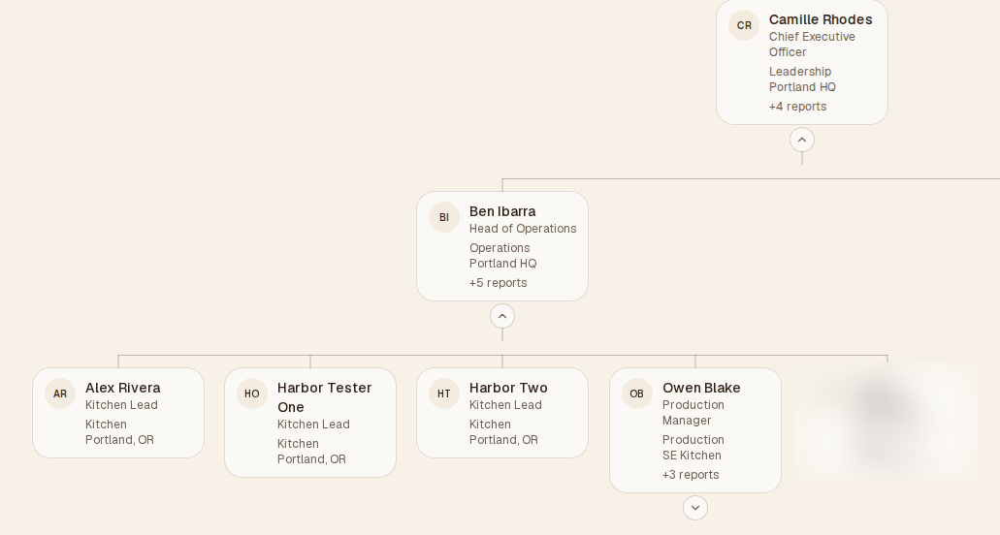

*One card is blurred in this screenshot on purpose.*

---

## Employment history

Job, pay, and manager changes are kept as dated history. A job change covers title, department, and location. Each entry records a reason, who made the change, and a source: hire, edit, restructure, coverage decision, or import. A future-dated change takes effect on its date.

---

## Leave desk

Leave sits in Time.

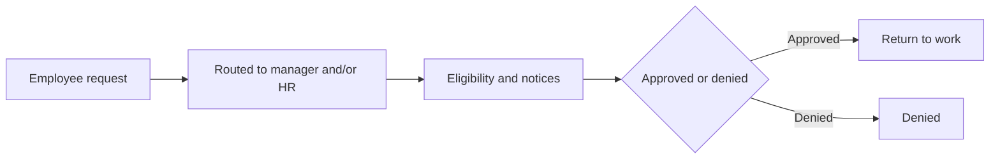

An employee requests leave with a plain-language picker: own health, a family member, a new child, military, or other. The product suggests leave types for that employee's state. Suggestions include intermittent leave and the option to use paid leave. New time-off requests skip company holidays.

HR works from a queue. The queue has an FMLA-style eligibility calculator, notice and certification deadlines, and the required notices. Intermittent leave tracks hours. Overlapping leave banks are drawn down together.

Leave types are grouped by jurisdiction: federal, plus California, Arizona, Utah, Oregon, and Nevada so far. A company can add its own leave types.

Managers get a dates-only toolkit: a team calendar, coverage overlap, expected return, tasks, and plain-language guidance on what a manager may and may not ask. Managers never see the reason, the notices, or medical documents.

Company settings decides who receives a request: the direct manager, HR, or both. Each leave type has an approval chain and a backup approver.

On a Soft file, leave stores only the reason category, dates, status, balances, and notice dates. A Soft file accepts no documents. On a Full file, medical certifications stay in a restricted medical file, separate from the personnel file. Every view of that file is logged.

### Coverage while a manager is on leave

When a manager with direct reports goes on leave for longer than one pay cycle, the leave asks who covers them. The default is that manager's own manager. Each report can have a different cover. Coverage follows the leave dates and ends when the leave ends. The permanent manager stays the same.

Approvals for time off and timesheets move with the coverage, along with unfinished reviews and interview slots.

A manager or HR can instead choose **Keep with** that person and push the due dates. Time-off, timecard, and expense approvals are never left waiting.

On return, a **Decide on return** task lets the employer hand the work back, or let the cover keep it for one to four weeks. Employees are told who their interim approver is. They are not told why.

---

## Person fallback

When work would go to someone who is terminated, exiting, or on leave, it goes at that moment to the next active person. The order is the manager's manager, then the department head, then an HR admin, then the company owner. The company can adjust this order in Company settings. Every fallback is logged. A picker warns who the work will go to.

Owners and partners can be set to **Top of company (no manager)**. They are not flagged as missing a manager. The company chooses who approves their requests.

---

## Exits

Offboarding works on Soft and Full. There are six exit types. Exits lives under People.

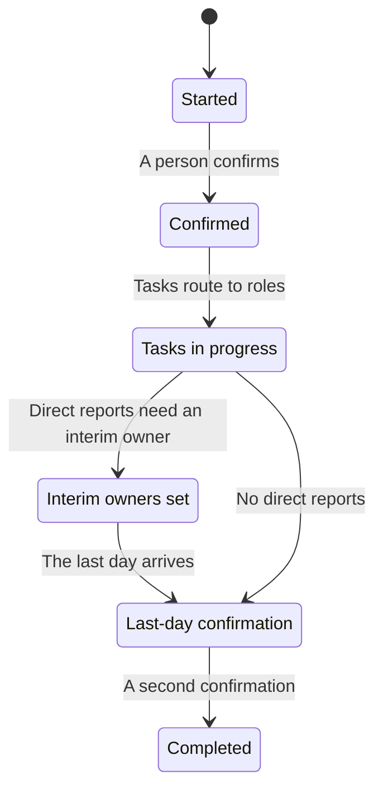

Starting an exit never terminates anyone. A person confirms the exit. A second confirmation on the last day completes it. When the person has direct reports, that confirmation waits until every report has an interim owner. Completion removes the person from the directory and from messaging, and ends their sign-in access.

An exit for someone with direct reports asks **Who takes over temporary management/oversight?** It suggests the first eligible person from the fallback chain.

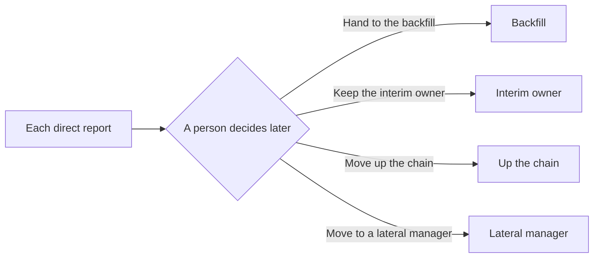

An employee can submit a resignation in the app. Rehire eligibility is enforced at Hire.

Exit tasks route to roles: IT, Payroll, Benefits, Facilities, Manager, and HR. Due dates are relative to the last day. The holder gets a reminder the day before. If a task is overdue, or the task holder is the person leaving, it escalates to a backup role, then to a company admin.

Final-pay guidance follows the work state's rule. It never waits on property return. Company property is tracked as returned, not returned, or written off. Release-agreement timing rules for employees 40 and older are built in.

The exits page is a short in-process list. Each row shows the name, the type, the last day, and progress. The exit template is pre-filled with recommended defaults, and an admin can edit it. My Desk shows a **My exit tasks** widget. Each exit has an append-only audit log.

Soft keeps the reason category, notes, and document names. Full adds separation and release documents.

---

## Applicant tracking

- Job postings, applications, and candidate notes.
- Jobs can be filtered by status, location, and department.
- A job can be **Paused**. It keeps its pipeline and disappears from the career page. The apply link says it isn't accepting applications right now.
- Job setup is collapsed, so the candidate pipeline comes first.
- Interviewers can be assigned on each stage of a job. A calendar stage can queue a scheduling invite.
- Applications can be corrected by an admin, and every change is logged.
- **Offer** and **reject** are separate actions. Sending an offer, and the candidate accepting it, completes the matching hiring checklist steps. The Hire form's start date then defaults to the start date in the accepted offer.
- **Panel interviews**, where several interviewers share one calendar invite.
- Interviewers get calendar invites. Candidates can't add guests; interviewers can.
- Booking a video interview creates a real video meeting link on a single calendar event.
- After booking, the candidate gets **Add to your calendar** for Google Calendar, Outlook, and Apple or another calendar.

**AI-assisted resume prefill** fills the application form from an uploaded resume. The applicant reviews every field before submitting. If that step is unavailable, a basic parser fills the form instead, and the applicant still reviews every field.

### Calendar-aware self-scheduling

Candidates pick their own interview time from openings computed **live** from the interviewers' calendars:

- Only events marked **Busy** block a time. Events marked **Free**, including all-day events, leave the time open.
- Openings are recalculated every time the page loads; they are never frozen when the invite is sent.
- If calendar availability can't be read, scheduling falls back to company business hours.
- Times show in both the company's time zone and the candidate's local time zone.

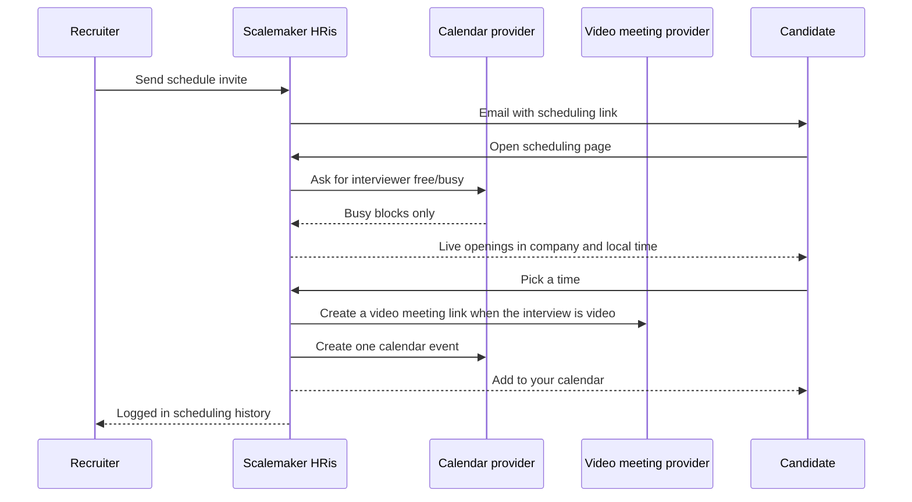

### Rescheduling with limits

- **Candidate reschedule.** The candidate picks a new time from live openings. The **same calendar event is updated**, not duplicated. The number of moves is limited (default 2) and there is a cutoff (default 24 hours before the interview). Past either limit, the candidate is asked to contact the recruiter. Limits are enforced on the server, not only in the page.
- **Ask candidate to reschedule.** An interviewer or recruiter can ask for a new time and add a note. The interview shows *Pending reschedule*, and the ask doesn't count against the candidate's limit.
- **Panel swap.** A panel member can be replaced without contacting the candidate. The new person must be free at that time.
- **Candidate cancel** flags the recruiter and leaves the application open. Nothing is rejected automatically.
- Limits are configurable in Recruiting settings.

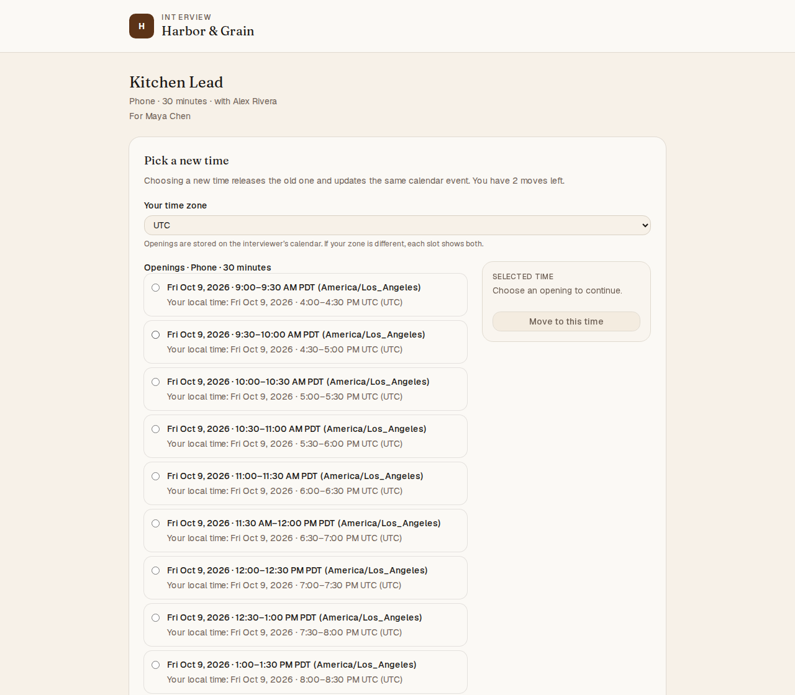

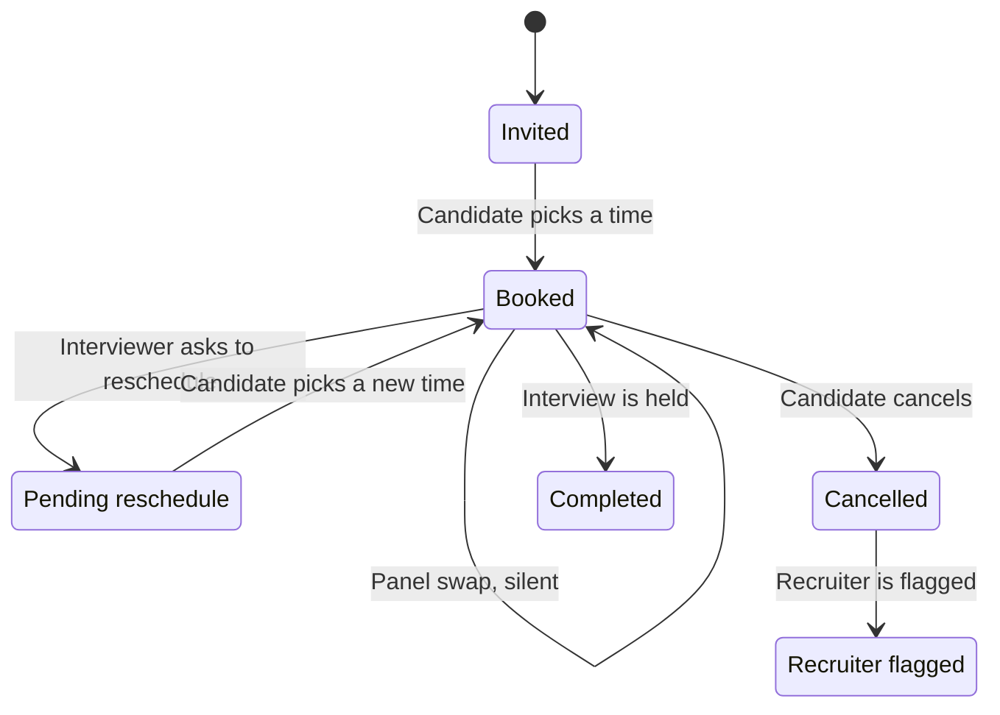

### Scheduling history

System scheduling activity is kept apart from human interview notes:

- Every invite, booking, reschedule, ask, panel swap, and cancellation is recorded in a **Scheduling history** panel.
- Entries are **append-only**. They can't be edited or deleted.
- Times show in the company's time zone.
- The history can be printed or exported to CSV.
- Human interview and phone-screen notes stay in candidate Notes.

### Voluntary EEO

Applicants on Soft and Full can complete a voluntary EEO self-identification. Every question can be skipped, or answered **Decline to self-identify**. Answers are kept apart from the application. They are never shown in hiring views. Reports show aggregate EEO-1 counts only, with no per-person list.

---

## Compliance

A company can set due dates per state for Form I-9, Form W-4, state withholding forms, and new-hire reporting. When the company has not set a date, the built-in table is used.

Each current person shows as **Done**, **Overdue**, **Due today**, **Due**, or **Optional**. An overdue item goes to the manager. If the manager cannot take it, it follows the person fallback chain.

---

## Admin assist

An admin can assist an employee by seeing the same screens that employee sees. A banner in the top bar makes this obvious:

> **Assisting Avery Quinn**
> Same screens they see. Saves and punches audit as you, not as them.

Every save or time punch made while assisting is recorded under the **admin's** identity, never the employee's. **Exit assist** sits at the far right of the banner.

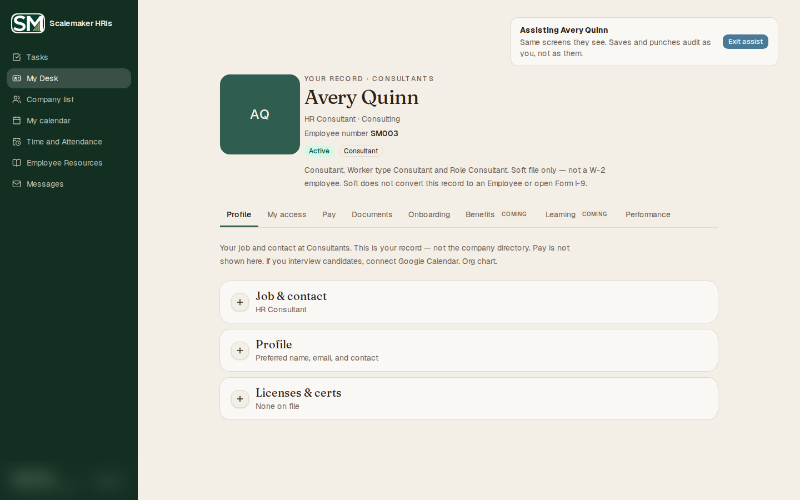

*The signed-in admin's name is blurred in the lower-left corner.*

---

## Company settings

Company settings holds the lists the rest of the product uses.

**Departments.** A company can keep a department list. A department can include a cost code, a GL code, a parent department, and a department head. Each of those is optional. A department can be archived. Jobs, hiring, and people pick from this list.

**Holidays.** A recurring holiday can be a fixed date, the nth weekday of a month, the last weekday of a month, or an Easter-based date. The company chooses the weekend observance. Presets cover US federal holidays and common extras. A preview shows the next three years. New time-off requests skip these holidays.

**Document types.** The company defines its own document types. A type can be renamed or archived, and the files stay as they are.

**Contacts.** The company can keep its own contacts.

**Auto-hire when an offer is accepted** lives here. Hire on acceptance runs only when this is turned on.

The fallback order can be adjusted here as well.

---

## Adding a new State?

Company admins open this guide in Company settings. They pick any of the 50 states or the District of Columbia. The checklist is grouped by topic:

- Paid sick leave
- Leave
- Final pay
- Meal and rest breaks
- Pay frequency
- Posters
- New-hire reporting
- State withholding
- Monitoring notices
- Local ordinances

Each item shows the employer-size threshold, who it covers, the rule in short, and its source. Items are badged **Not yet verified** or **Confirm with counsel** where that applies. Unsourced items are hidden.

The page states that this is HR guidance, not legal advice, and that the product does not certify state compliance. The guide is maintained as data, so it can be updated without changing the screens.

---

## AI advisor

The AI advisor runs only on fictional demo companies.

It is a read-only guide. It helps a person find the right screen. It also offers a de-identified workforce view, with no names or contact details. Small groups are suppressed.

A suggestion is applied in two steps, and only by a person. A permitted person reviews a plain list of suggested changes, then confirms. The advisor never acts on its own. Only low-risk changes are allowed, such as reassigning a manager, moving a department, or assigning a task. Terminations, pay, and permissions are refused. Manager and department changes can be undone.

---

## High-level architecture

The diagram is intentionally general. It shows the product's shape, not implementation details.

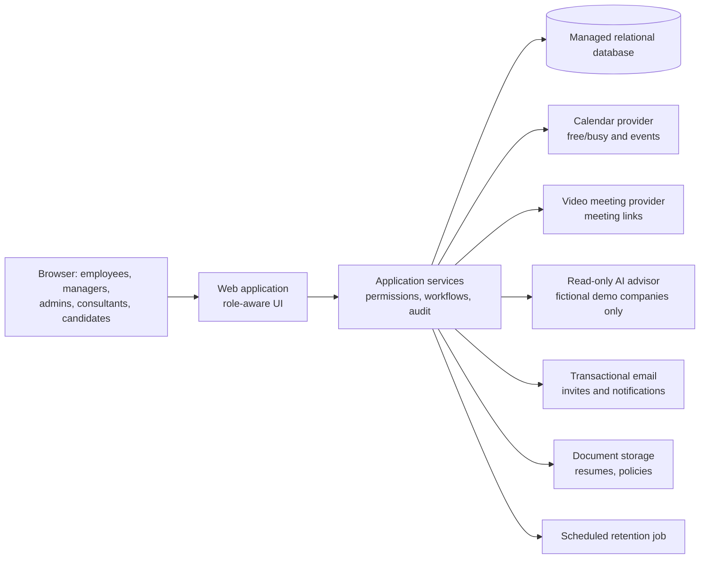

Design principles:

- **Permissions are checked on the server** for every action. The UI only reflects what the server allows.
- **A person confirms.** A person extends every offer, and the candidate accepts. Hire runs on acceptance only when the company has turned that on. Nothing rejects a candidate on its own. The advisor suggests, a person confirms, and it runs only on fictional demo companies.
- **Audit by default.** Corrections, assists, scheduling events, investigation actions, exit actions, and fallbacks are attributed to the person who acted.
- **Scheduled retention.** Deleted messages stay until the company period ends. A legal hold stops removal.
- **Data minimization.** Soft never stores sensitive PII, and Full stays limited to test data until it has been independently assessed.
- **Every change ships through review.** Each change goes through a pull request, automated checks, and production verification.

---

## About this showcase

- All names, companies, and records in the screenshots are **fictional demo data**.
- Screenshots were cropped to remove browser chrome, stripped of image metadata, and blurred where needed.
- The product source code is private and is not included here.
