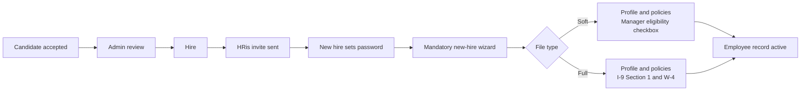
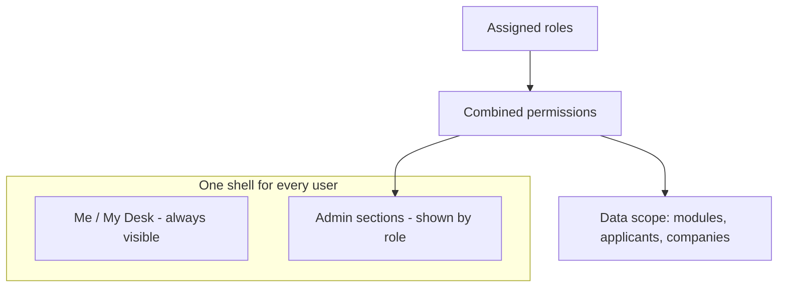
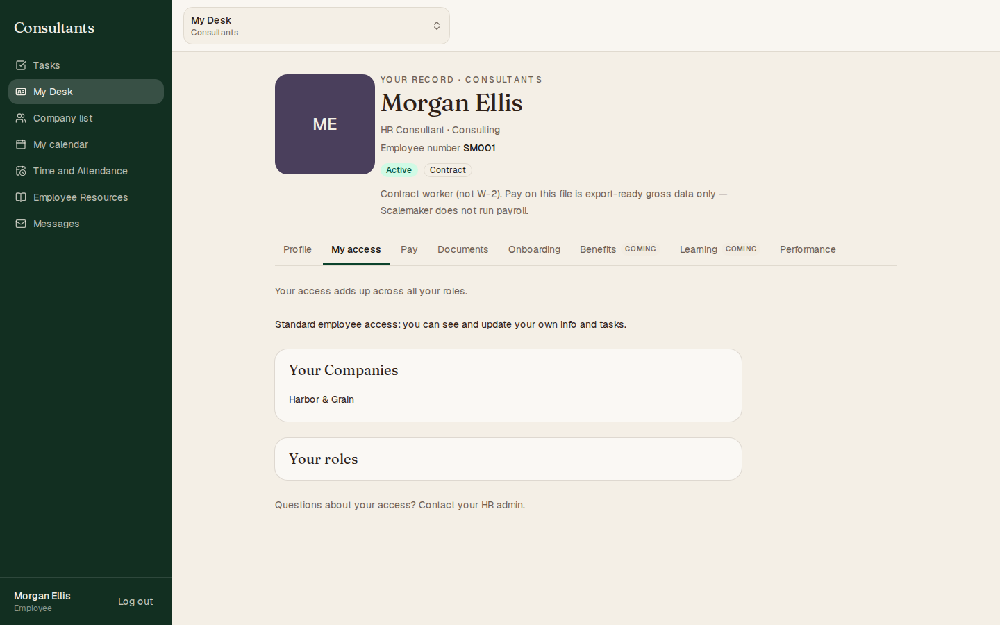
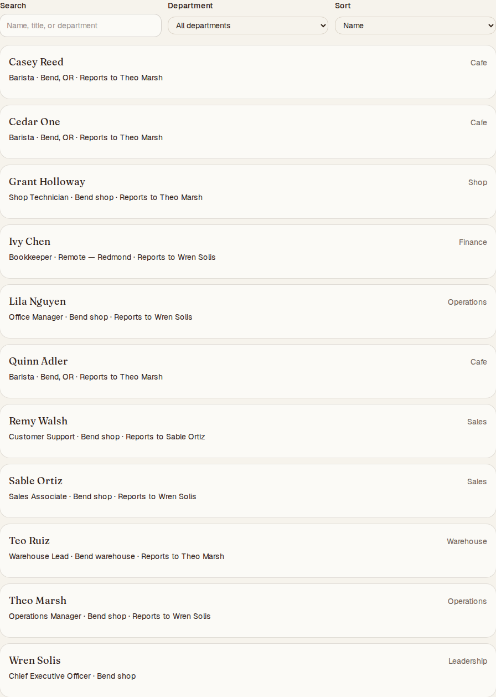
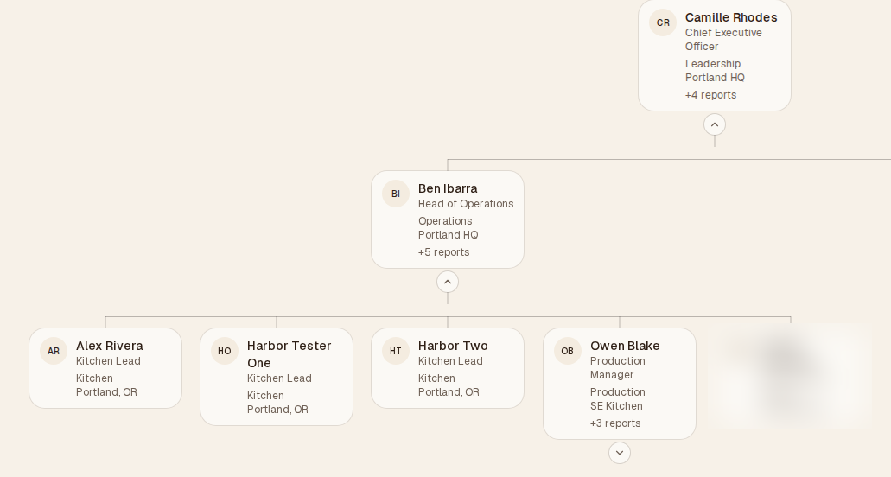
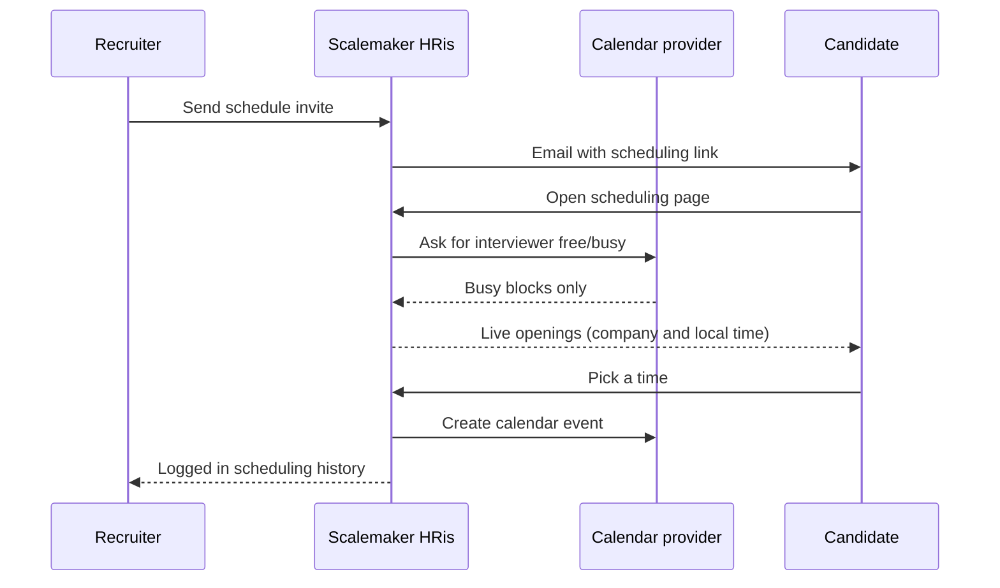
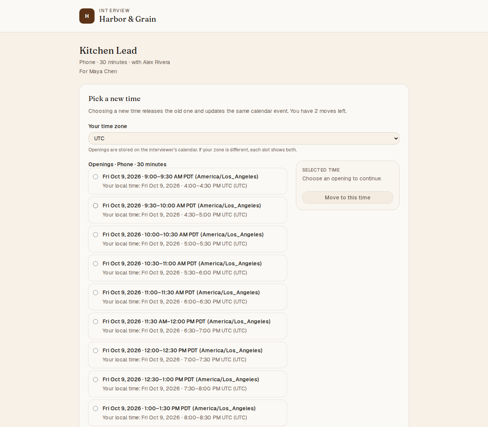
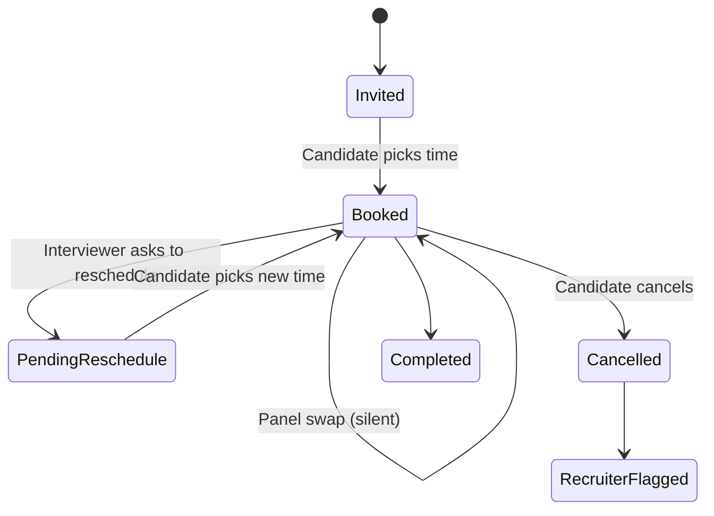
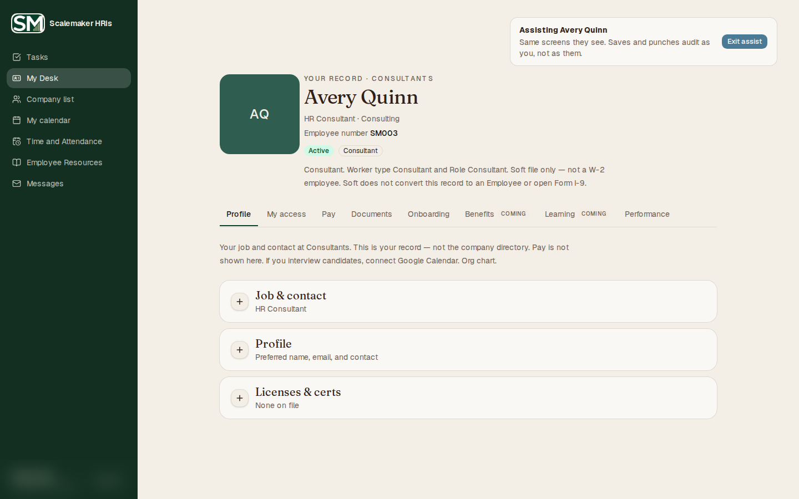
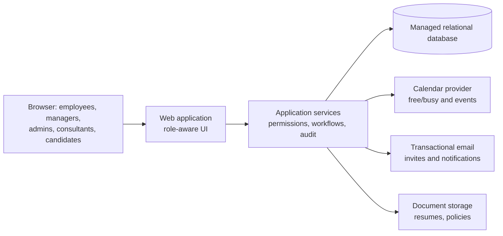

# Scalemaker HRis — Product Showcase

Scalemaker HRis is an HRIS and applicant tracking system (ATS) built for small employers and the HR consultants who support them. It covers the full employee lifecycle in one place: recruiting, hiring, onboarding, the employee record, time and attendance, and company structure.

This repository is a **portfolio showcase**. It describes the product's design and shows screenshots taken in a demo environment. It contains no application source code, no configuration, and no customer data. Every person and company shown is a fictional demo record.

---

## Highlights

- **Two-tier data model (Soft and Full)** that lets a company start without collecting sensitive personal data.
- **Human-decides gates.** The system never hires anyone on its own.
- **Guided hire-to-onboard flow**: Hire, HRis invite, set password, mandatory new-hire wizard.
- **One role-aware shell.** Every user gets the same layout, and the menus adapt to their roles.
- **Fine-grained roles** with per-module permissions and applicant scope.
- **Multi-company consulting.** Consultants see only the companies assigned to them.
- **ATS with panel interviews, calendar-aware self-scheduling, rescheduling with limits, and an append-only scheduling history.**
- **Admin assist** with a clear banner and full audit attribution.

---

## Soft vs Full

Scalemaker HRis has two file types with the **same information architecture**. Users learn one set of screens, and the file type decides which data can be stored.

| | Soft | Full |
|---|---|---|
| Purpose | Day-to-day people operations without sensitive PII | Complete employment records, including sensitive PII |
| Sensitive PII | Never stored | Supported |
| New-hire wizard | No employee I-9; the manager confirms eligibility with a checkbox | Includes I-9 Section 1 and W-4 |
| Current status | In use | Holds fictional testers only until a penetration test and SOC 2 are complete |

Because the screens are the same, a company can move from Soft to Full later without retraining anyone.

---

## Human-decides gates

Automation helps, but people make the hiring decisions:

1. A hiring manager or interviewer chooses **Accept** on a candidate.
2. An **admin reviews** the accepted candidate.
3. An admin chooses **Hire**.

The system never auto-hires, and knockout logic never rejects anyone on its own.

---

## Hire to onboard

The wizard is mandatory. A new hire cannot reach the rest of the app until it is complete.

---

## One role-aware shell

Every user, whether employee, manager, admin, or consultant, signs in to the same shell:

- **Me / My Desk** stays at the top of the navigation (sticky). It holds your own record, tasks, calendar, time and attendance, resources, and messages.
- **Admin** sections appear below it only for users whose roles grant them.

### Roles and permissions

- Roles carry **per-module permissions** that can be expanded down to individual items.
- Built-in roles can be edited, and custom roles can be added.
- Recruiting roles include an **applicant scope**, so a user sees only the candidates they are meant to see.
- Managers see their reporting line.
- A user's access is the **sum of all their roles**, shown plainly on their own *My access* tab.

### Consultants and multiple companies

HR consultants can serve several client companies. A consultant sees **only the companies assigned to them**, listed under *Your Companies* on their My access tab.

---

## Company directory

Every employee can browse a company directory that shows each person's name, title, and department, plus only the extra fields that person chooses to share. The directory is separate from role-based visibility and never shows sensitive PII.

## Org chart

A top-down, collapsible org chart is built from reporting lines. Admins also get a restructure mode for planning changes.

*One card is blurred in this screenshot on purpose.*

---

## Applicant tracking

- Job postings, applications, and candidate notes.
- Applications can be corrected by an admin, and every change is logged.
- **Panel interviews**, where several interviewers share one calendar invite.
- Interviewers get calendar invites. Candidates can't add guests; interviewers can.

### Calendar-aware self-scheduling

Candidates pick their own interview time from openings computed **live** from the interviewers' calendars:

- Only events marked **Busy** block a time. Events marked **Free**, including all-day events, leave the time open.
- Openings are recalculated every time the page loads; they are never frozen when the invite is sent.
- If calendar availability can't be read, scheduling falls back to company business hours.
- Times show in both the company's time zone and the candidate's local time zone.

### Rescheduling with limits

- **Candidate reschedule.** The candidate picks a new time from live openings. The **same calendar event is updated**, not duplicated. The number of moves is limited (default 2) and there is a cutoff (default 24 hours before the interview). Past either limit, the candidate is asked to contact the recruiter. Limits are enforced on the server, not only in the page.
- **Ask candidate to reschedule.** An interviewer or recruiter can ask for a new time and add a note. The interview shows *Pending reschedule*, and the ask doesn't count against the candidate's limit.
- **Panel swap.** A panel member can be replaced without contacting the candidate. The new person must be free at that time.
- **Candidate cancel** flags the recruiter and leaves the application open. Nothing is rejected automatically.
- Limits are configurable in Recruiting settings.

### Scheduling history

System scheduling activity is kept apart from human interview notes:

- Every invite, booking, reschedule, ask, panel swap, and cancellation is recorded in a **Scheduling history** panel.
- Entries are **append-only**. They can't be edited or deleted.
- Times show in the company's time zone.
- The history can be printed or exported to CSV.
- Human interview and phone-screen notes stay in candidate Notes.

---

## Admin assist

An admin can assist an employee by seeing the same screens that employee sees. A banner in the top bar makes this obvious:

> **Assisting Avery Quinn**
> Same screens they see. Saves and punches audit as you, not as them.

Every save or time punch made while assisting is recorded under the **admin's** identity, never the employee's. **Exit assist** sits at the far right of the banner.

*The signed-in admin's name is blurred in the lower-left corner.*

---

## High-level architecture

The diagram is intentionally general. It shows the product's shape, not implementation details.

Design principles:

- **Permissions are checked on the server** for every action. The UI only reflects what the server allows.
- **Audit by default.** Corrections, assists, and scheduling events are attributed to the person who acted.
- **Data minimization.** Soft never stores sensitive PII, and Full stays limited to test data until it has been independently assessed.
- **Every change ships through review.** Each change goes through a pull request, automated checks, and production verification.

---

## About this showcase

- All names, companies, and records in the screenshots are **fictional demo data**.
- Screenshots were cropped to remove browser chrome, stripped of image metadata, and blurred where needed.
- The product source code is private and is not included here.
