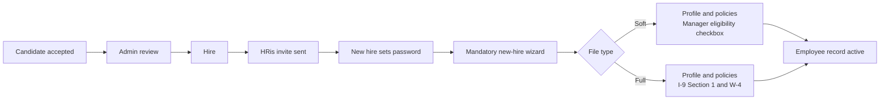
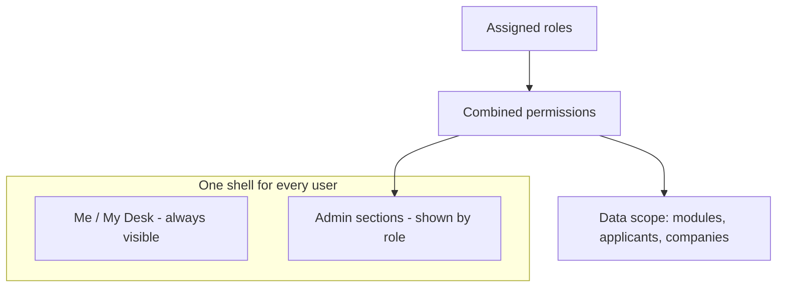
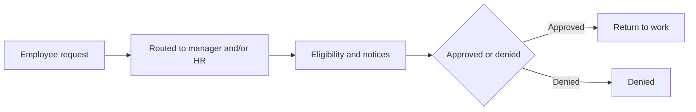
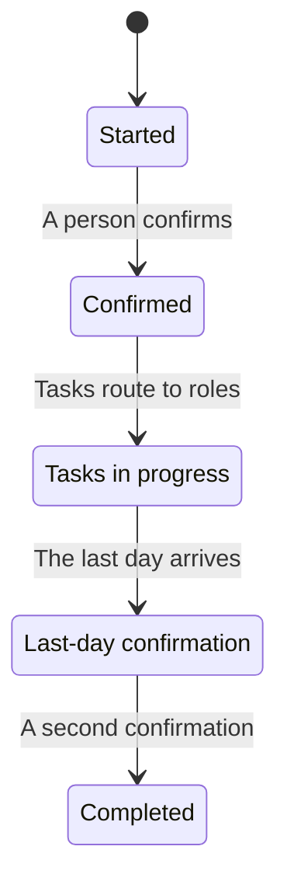
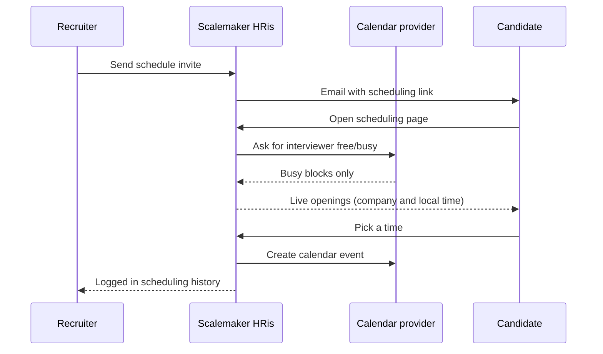
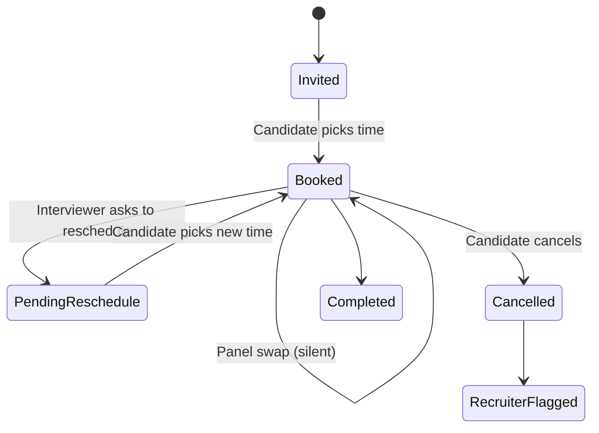
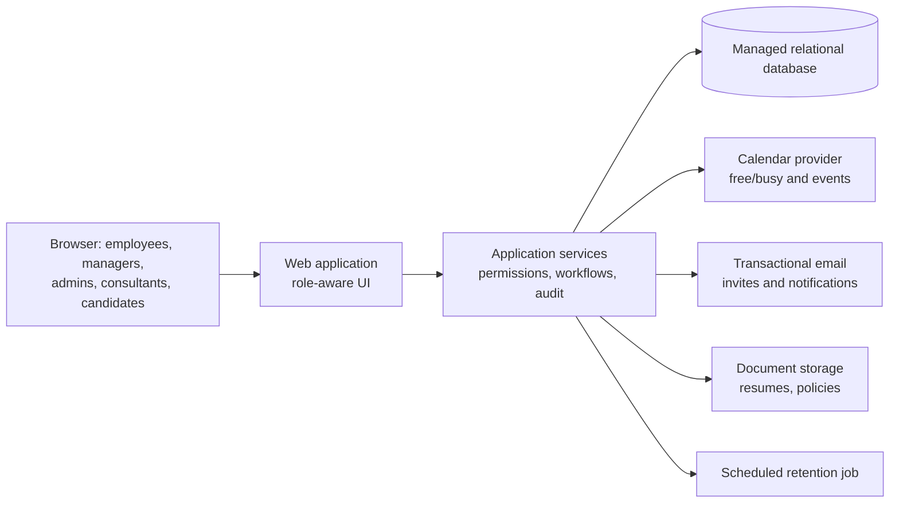

# Scalemaker HRis — Product Showcase

Scalemaker HRis is an HRIS and applicant tracking system (ATS) built for small employers and the HR consultants who support them. It covers the full employee lifecycle in one place: recruiting, hiring, onboarding, the employee record, time and attendance, leave, messaging, offboarding, and company structure.

This repository is a **portfolio showcase**. It describes the product's design and shows screenshots taken in a demo environment. It contains no application source code, no configuration, and no customer data. Every person and company shown is a fictional demo record.

---

## Highlights

- **Two-tier data model (Soft and Full)** that lets a company start without collecting sensitive personal data.
- **Human-decides gates.** The system never hires anyone on its own.
- **Guided hire-to-onboard flow**: Hire, HRis invite, set password, mandatory new-hire wizard. An accepted offer completes the matching checklist steps, and the Hire start date defaults to that offer.
- **One role-aware shell.** Every user gets the same layout, and the menus adapt to their roles.
- **Fine-grained roles** with per-module permissions and applicant scope.
- **Multi-company consulting.** Consultants see only the companies assigned to them.
- **ATS with panel interviews, calendar-aware self-scheduling, rescheduling with limits, and an append-only scheduling history.**
- **Company directory** of active employees, paged and filterable by name, location, and department.
- **Message Center** for employee messaging, off until the company turns it on, with private folders, retention, and a separate investigations permission.
- **Leave desk** in Time and Attendance. Managers see dates only.
- **Exits** for Soft and Full. A person confirms the exit, tasks route to roles, and a last-day confirmation completes it.
- **Adding a new State?** guide in Company setup. It is HR guidance, not legal advice.
- **Admin assist** with a clear banner and full audit attribution.

---

## Soft vs Full

Scalemaker HRis has two file types with the **same information architecture**. Users learn one set of screens, and the file type decides which data can be stored.

| | Soft | Full |
|---|---|---|
| Purpose | Day-to-day people operations without sensitive PII | Complete employment records, including sensitive PII |
| Sensitive PII | Never stored | Supported |
| New-hire wizard | No employee I-9; the manager confirms eligibility with a checkbox | Includes I-9 Section 1 and W-4 |
| Leave | Reason category, dates, status, balances, and notice dates; no documents | Medical certifications in a restricted medical file, separate from the personnel file; every view is logged |
| Exits | Reason category, notes, and document names | Reason category, notes, document names, and separation and release documents |
| Current status | In use | Holds fictional testers only until a penetration test and SOC 2 are complete |

Because the screens are the same, a company can move from Soft to Full later without retraining anyone.

---

## Human-decides gates

Automation helps, but people make the hiring decisions:

1. A hiring manager or interviewer chooses **Accept** on a candidate.
2. An **admin reviews** the accepted candidate.
3. An admin chooses **Hire**.

The system never auto-hires, and knockout logic never rejects anyone on its own.

---

## Hire to onboard

The wizard is mandatory. A new hire cannot reach the rest of the app until it is complete.

Sending an offer, and the candidate accepting it, completes the matching hiring checklist steps. The Hire form's start date defaults to the start date in the accepted offer.

An admin can select several open onboarding tasks and email them to the new hire in one message. The admin previews the message first. It lists the task titles and due dates, and it includes a single sign-in link. It does not include personal details. On a Soft file, steps that stay with the manager are not selectable.

People search checks each word against the start of a name, so a last name on its own finds the person.

---

## One role-aware shell

Every user, whether employee, manager, admin, or consultant, signs in to the same shell:

- **Me / My Desk** stays at the top of the navigation (sticky). It holds your own record, tasks, calendar, time and attendance, leave, resources, messages, and exit tasks.
- **Admin** sections appear below it only for users whose roles grant them.

### Roles and permissions

- Roles carry **per-module permissions** that can be expanded down to individual items.
- Built-in roles can be edited, and custom roles can be added.
- Recruiting roles include an **applicant scope**, so a user sees only the candidates they are meant to see.
- Managers see their reporting line.
- A user's access is the **sum of all their roles**, shown plainly on their own *My access* tab.

### Consultants and multiple companies

HR consultants can serve several client companies. A consultant sees **only the companies assigned to them**, listed under *Your Companies* on their My access tab.

---

## Company directory

Every employee can browse the company directory. It lists active employees only. The list is paged, and it can be sorted and filtered by name, location, and department. Each row shows the name, job title, department, and location.

Opted-in profile notes stay on the person's profile. The directory is separate from role-based visibility and never shows sensitive PII.

When employee messaging is on, choosing a name opens a message.

## Message Center

A company setting turns employee-to-employee messaging on or off. It is off for a new company. When it is on, choosing a name in the directory opens a message.

The Inbox shows an unread count. Messages stay in threads, and people reply in the thread. A conversation is visible only to the people in it. The message list is newest first, and it is paged.

Each employee can create, rename, and delete private folders. They can move a message, or a whole thread, into a folder. Deleting a folder returns its messages to the Inbox.

The first time an employee uses messaging, they acknowledge a disclosure. The composer reminds people not to share sensitive personal data.

**Link email.** An employee can have a notification sent to an outside email. That email is only a sign-in link. It never includes the message, attachments, names, pay, or personal details.

Deleted messages are kept until the company's retention period ends. The default is 3 years from the message date. The shortest period is 1 year.

### Workplace investigations and legal hold

A separate permission lets a person review other employees' messages. It is off for everyone until it is granted.

A permitted person opens a case with a reason, the named employees, and a date range. They can then read those threads. The review is read-only. Nobody can open a case on themselves.

Opening a case prompts a legal hold. Messages under hold are never removed by retention.

Every case action goes into an append-only log: opened, viewed, exported, and hold placed or released. The person being investigated cannot see the log. Exports are watermarked with the case reference.

## Org chart

A top-down, collapsible org chart is built from reporting lines. Admins also get a restructure mode for planning changes.

*One card is blurred in this screenshot on purpose.*

---

## Leave desk

Leave is a tab in Time and Attendance.

An employee requests leave with a plain-language picker: own health, a family member, a new child, military, or other. The product suggests leave types for that employee's state. Suggestions include intermittent leave and the option to use paid leave.

HR works from a queue. The queue has an FMLA-style eligibility calculator, notice and certification deadlines, and the required notices. Intermittent leave tracks hours. Overlapping leave banks are drawn down together.

Leave types are grouped by jurisdiction: federal, plus California, Arizona, Utah, Oregon, and Nevada so far. A company can add its own leave types.

Managers get a dates-only toolkit: a team calendar, coverage overlap, expected return, tasks, and plain-language guidance on what a manager may and may not ask. Managers never see the reason, the notices, or medical documents.

Company setup decides who receives a request: the direct manager, HR, or both. Each leave type has an approval chain and a backup approver.

On a Soft file, leave stores only the reason category, dates, status, balances, and notice dates. A Soft file accepts no documents. On a Full file, medical certifications stay in a restricted medical file, separate from the personnel file. Every view of that file is logged.

---

## Exits

Offboarding works on Soft and Full. There are six exit types.

Starting an exit never terminates anyone. A person confirms the exit. A second confirmation on the last day completes it. Completion removes the person from the directory and from messaging, and ends their sign-in access.

An employee can submit a resignation in the app. Rehire eligibility is enforced at Hire.

Exit tasks route to roles: IT, Payroll, Benefits, Facilities, Manager, and HR. Due dates are relative to the last day. The holder gets a reminder the day before. If a task is overdue, or the task holder is the person leaving, it escalates to a backup role, then to a company admin.

Final-pay guidance follows the work state's rule. It never waits on property return. Company property is tracked as returned, not returned, or written off. Release-agreement timing rules for employees 40 and older are built in.

The exits page is a short in-process list. Each row shows the name, the type, the last day, and progress. The exit template is pre-filled with recommended defaults, and an admin can edit it. My Desk shows a **My exit tasks** widget. Each exit has an append-only audit log.

Soft keeps the reason category, notes, and document names. Full adds separation and release documents.

---

## Applicant tracking

- Job postings, applications, and candidate notes.
- Applications can be corrected by an admin, and every change is logged.
- Sending an offer, and the candidate accepting it, completes the matching hiring checklist steps. The Hire form's start date then defaults to the start date in the accepted offer.
- **Panel interviews**, where several interviewers share one calendar invite.
- Interviewers get calendar invites. Candidates can't add guests; interviewers can.

### Calendar-aware self-scheduling

Candidates pick their own interview time from openings computed **live** from the interviewers' calendars:

- Only events marked **Busy** block a time. Events marked **Free**, including all-day events, leave the time open.
- Openings are recalculated every time the page loads; they are never frozen when the invite is sent.
- If calendar availability can't be read, scheduling falls back to company business hours.
- Times show in both the company's time zone and the candidate's local time zone.

### Rescheduling with limits

- **Candidate reschedule.** The candidate picks a new time from live openings. The **same calendar event is updated**, not duplicated. The number of moves is limited (default 2) and there is a cutoff (default 24 hours before the interview). Past either limit, the candidate is asked to contact the recruiter. Limits are enforced on the server, not only in the page.
- **Ask candidate to reschedule.** An interviewer or recruiter can ask for a new time and add a note. The interview shows *Pending reschedule*, and the ask doesn't count against the candidate's limit.
- **Panel swap.** A panel member can be replaced without contacting the candidate. The new person must be free at that time.
- **Candidate cancel** flags the recruiter and leaves the application open. Nothing is rejected automatically.
- Limits are configurable in Recruiting settings.

### Scheduling history

System scheduling activity is kept apart from human interview notes:

- Every invite, booking, reschedule, ask, panel swap, and cancellation is recorded in a **Scheduling history** panel.
- Entries are **append-only**. They can't be edited or deleted.
- Times show in the company's time zone.
- The history can be printed or exported to CSV.
- Human interview and phone-screen notes stay in candidate Notes.

---

## Admin assist

An admin can assist an employee by seeing the same screens that employee sees. A banner in the top bar makes this obvious:

> **Assisting Avery Quinn**
> Same screens they see. Saves and punches audit as you, not as them.

Every save or time punch made while assisting is recorded under the **admin's** identity, never the employee's. **Exit assist** sits at the far right of the banner.

*The signed-in admin's name is blurred in the lower-left corner.*

---

## Adding a new State?

Company admins open this guide in Company setup. They pick any of the 50 states or the District of Columbia. The checklist is grouped by topic:

- Paid sick leave
- Leave
- Final pay
- Meal and rest breaks
- Pay frequency
- Posters
- New-hire reporting
- State withholding
- Monitoring notices
- Local ordinances

Each item shows the employer-size threshold, who it covers, the rule in short, and its source. Items are badged **Not yet verified** or **Confirm with counsel** where that applies. Unsourced items are hidden.

The page states that this is HR guidance, not legal advice, and that the product does not certify state compliance. The guide is maintained as data, so it can be updated without changing the screens.

---

## High-level architecture

The diagram is intentionally general. It shows the product's shape, not implementation details.

Design principles:

- **Permissions are checked on the server** for every action. The UI only reflects what the server allows.
- **Audit by default.** Corrections, assists, scheduling events, investigation actions, and exit actions are attributed to the person who acted.
- **Scheduled retention.** Deleted messages stay until the company period ends. A legal hold stops removal.
- **Data minimization.** Soft never stores sensitive PII, and Full stays limited to test data until it has been independently assessed.
- **Every change ships through review.** Each change goes through a pull request, automated checks, and production verification.

---

## About this showcase

- All names, companies, and records in the screenshots are **fictional demo data**.
- Screenshots were cropped to remove browser chrome, stripped of image metadata, and blurred where needed.
- The product source code is private and is not included here.
